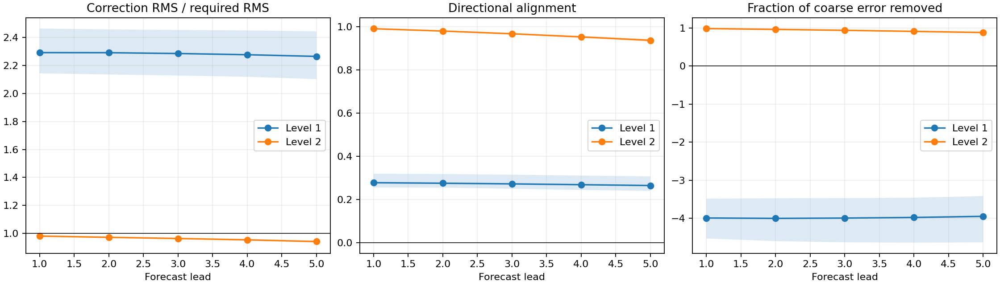
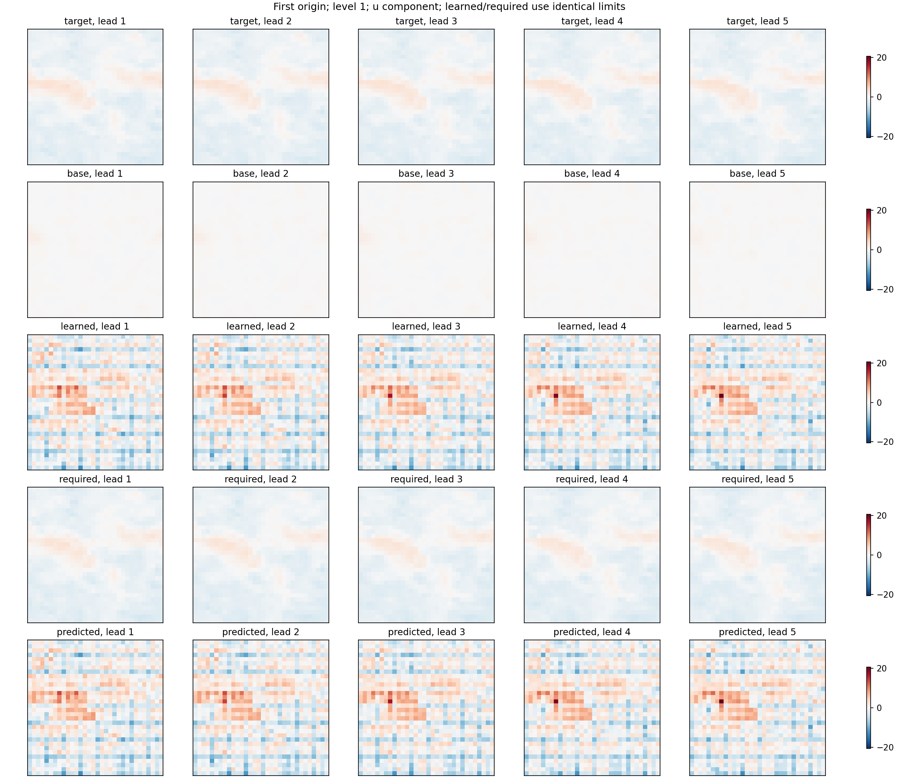
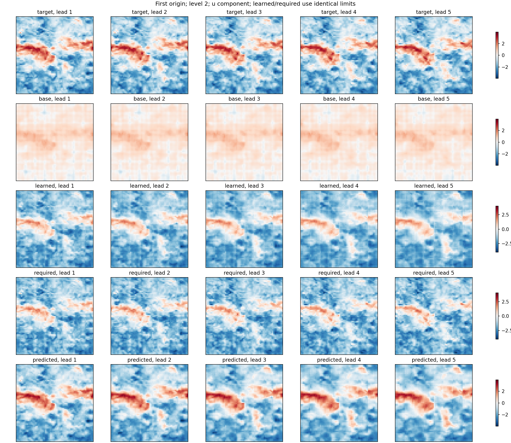

# MATEY correction diagnostic

No training, rescaling, or target feedback. Same saved checkpoint throughout.

RMS ratio measures strength; cosine measures alignment; error reduction measures usefulness. An RMS ratio below one alone does not establish under-correction. oracle_alpha is a signed least-squares multiplier calculated using ground truth, not a deployable fix.

Intermediate-level physical-unit views apply that level's input-history mean/std. Upstream only denormalizes the finest return; intermediate views are diagnostic mappings, not separately emitted physical forecasts. Required correction is target minus this level's upsampled base, not the true high-pass component or an independently supervised target.

Ranges across overlapping origins are descriptive, not confidence intervals. Autonomous rollout uses predictions only after the initial four observed frames.

