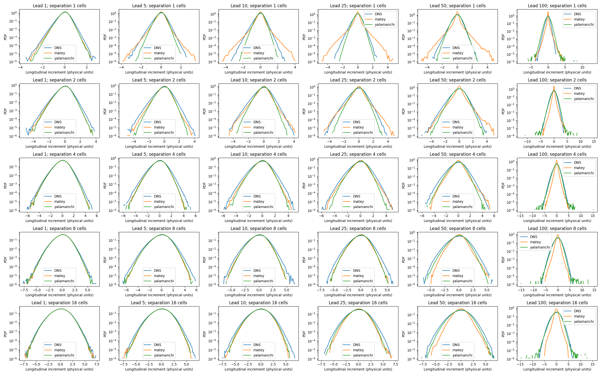
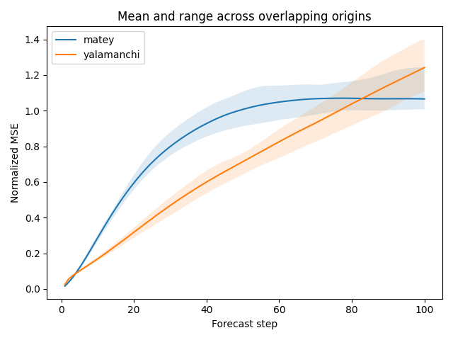
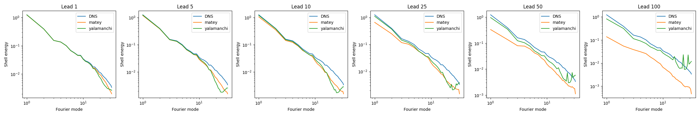
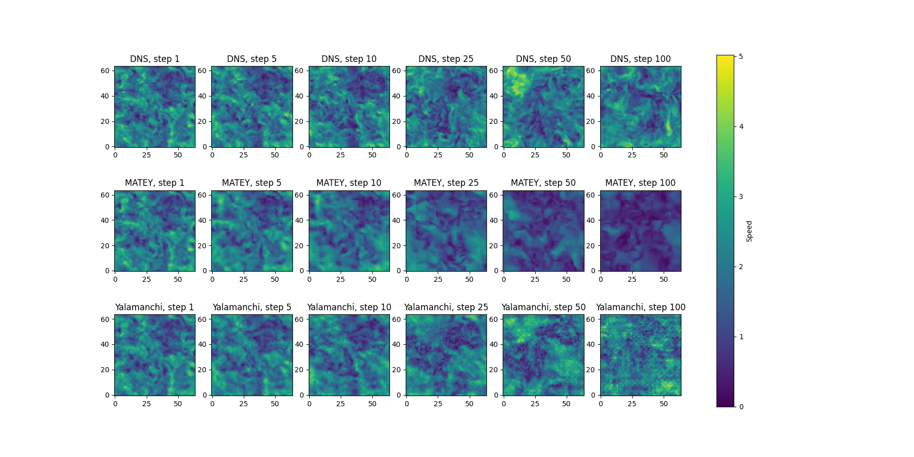
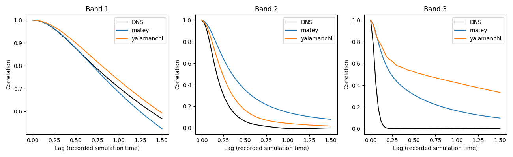

# Rollout statistics

8 common test origins, 100 autonomous steps. No retraining.

Origins overlap; ranges are descriptive, not independent-sample confidence intervals.
MATEY uses four observed frames; Yalamanchi uses the last one. This is a checkpoint comparison, not a controlled architecture ablation.
Autocorrelations use predicted frames only, all valid pairs, excluding spatial mean; they include Eulerian advection.
PDFs use fixed physical-unit bins; out-of-range tail probabilities are saved in each NPZ.
See spec.json for checkpoints, epochs, origin indices, times, bands, and separations.

